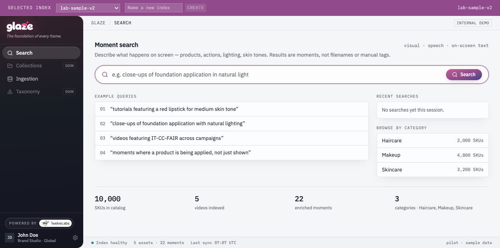
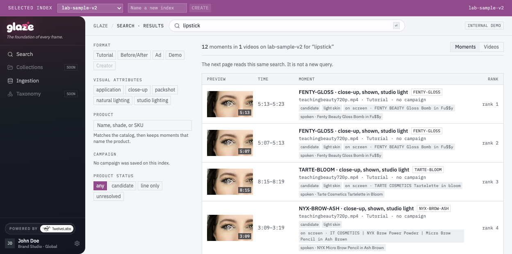
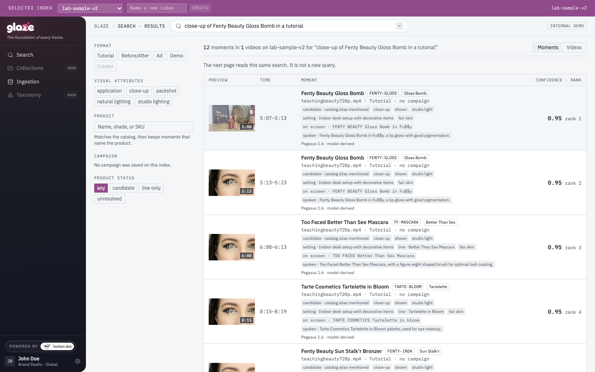
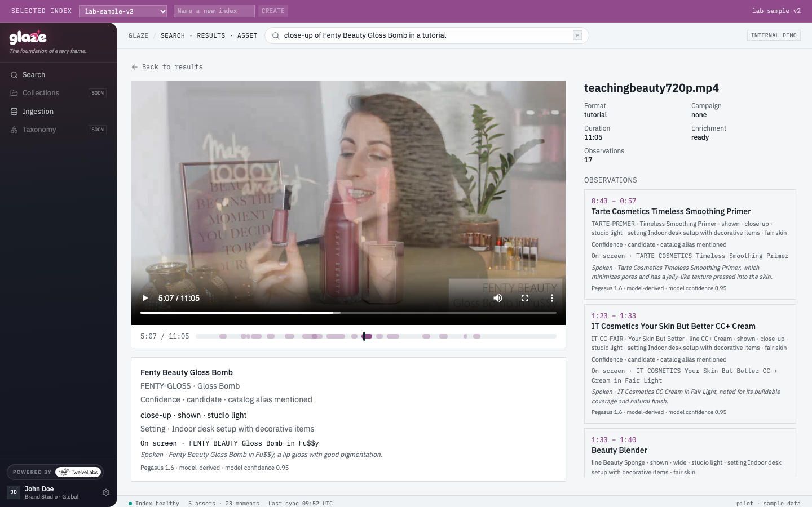
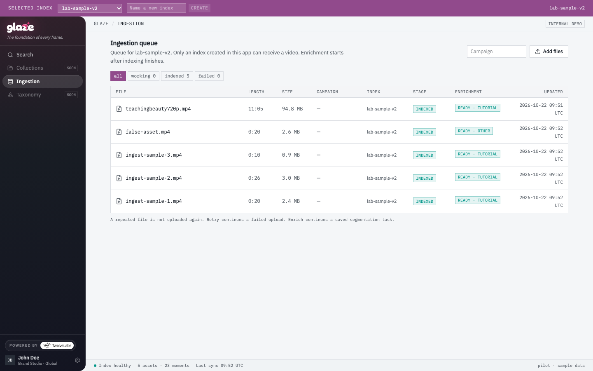

# ✨ Glaze

Glaze finds a **moment** inside a marketing video. You describe what happens on screen. The result is a time range, a thumbnail of that span, and the product observation that overlaps it.

Search runs on a [TwelveLabs](https://www.twelvelabs.io/) index. Marengo 3.0 makes the video searchable. Pegasus 1.6 then writes what is visible or spoken. This app matches that text to a product in the local catalog. Opening a result plays the TwelveLabs HLS stream and seeks to the moment. Hovering a thumbnail plays that same span, muted, and loops it.

Collections and Taxonomy are still marked **soon**. This demo is search, playback, and ingest.

## 🧰 What you need

- Node.js 22 or newer
- [Bun](https://bun.sh/) for the UI (`bun.lock` at the repo root)
- npm for the API (`server/package-lock.json`)
- ffmpeg, because ingest checks the file with `ffprobe`
- A TwelveLabs API key from the [Playground](https://playground.twelvelabs.io/)

Check the tools:

```sh
node -v
bun -v
ffprobe -version
```

On macOS, `brew install ffmpeg` provides `ffprobe`.

## 🚀 Run it locally

From the repo root:

```sh
cp .env.example .env
```

Open `.env` and set `TWELVELABS_API_KEY`. The key stays on the server. Do not put it in a `VITE_` variable.

Install both sides, then start them in two terminals:

```sh
bun install
npm install --prefix server
```

```sh
node server/src/server.js
```

```sh
bun run dev
```

The API listens on `http://127.0.0.1:8787`. Vite proxies `/api` to it and prints the UI URL, which is `http://127.0.0.1:8080` in this repo.

The top bar lists indexes on the TwelveLabs account. **Add files** stays off until the selected index is one this app created. Type a name, choose **Create**, and that index becomes the one that can take a video. The model on a new index is Marengo 3.0 with visual and audio. It cannot be changed later.

## 🎥 Put a video in

Open **Ingestion**. Optionally type a campaign name, then **Add files**. You can also drop a file from the command line, which uses the index selected in the bar:

```sh
node server/cli/ingest.js ingest-assets/ingest-sample-1.mp4 --campaign "Second Skin SS26"
node server/cli/ingest.js --show <jobId>
```

`ingest-assets/` has short samples and one longer tutorial, `teachingbeauty720p.mp4`, which is the file in the screenshots below. Uploading, indexing, and enrichment spend TwelveLabs usage and take several minutes. A second run of the same bytes is reported as a duplicate and is not uploaded again.

The queue has two statuses. **Indexed** means Marengo finished. **Enrichment** means the Pegasus segmentation. Search can run after indexing. Product names, shots, and “shown” versus “applied” appear after enrichment is **ready**.

A file has to pass both models and the direct upload limit: up to 200 MB, from 4 seconds to 2 hours, and a frame from 360×360 through 5184×2160.

## 🔎 Search a moment

On the home page, type a sentence or use one of the example queries. Results are moments, not filenames.

- **Rank** is TwelveLabs’ ordering for that query. It is not a percentage and not a product probability.
- The chips (SKU, shot, lighting, on-screen text, spoken mention) come from the enrichment observation that overlaps the hit.
- Format, visual attributes, SKU, and product status are applied on this page after the search returns. A missing row is not proof the moment is absent from the index.
- **Creator** is disabled. The enrichment format is tutorial, demo, ad, before/after, or other.
- Hover a thumbnail to play the matched span. Leave the thumbnail and the still comes back.
- Open a row to play the HLS stream at that start time.

A query shaped like `videos featuring IT-CC-FAIR across campaigns`, or a search with exactly one SKU and no sentence, lists catalog matches from finished enrichment instead of asking TwelveLabs to rank a phrase.

The home-page counts mix two sources. The SKU total is the local catalog (`fixtures/catalog.json`, filled out to 10,000). Video and moment totals are the selected index.

## 🖼️ Screenshots

Taken on the `lab-sample-v2` index. Your index name and files will differ. The screens are the same.











## 🧪 Tests

Server tests do not call TwelveLabs. They inject a fake client:

```sh
npm test --prefix server
```

## 📚 TwelveLabs references

The API client is `twelvelabs-js` 1.3.6. These are the v1.3 pages this demo follows.

- [Manage indexes](https://docs.twelvelabs.io/v1.3/sdk-reference/node-js/manage-indexes) — create and list the Marengo index from the top bar.
- [Index content](https://docs.twelvelabs.io/v1.3/sdk-reference/node-js/index-content) — direct upload, `indexedAssets.create` with `enableVideoStream`, and the HLS `videoUrl` used for playback and thumbnails.
- [Upload methods](https://docs.twelvelabs.io/v1.3/docs/concepts/upload-methods) — direct local upload, and the 200 MB cap that is tighter than either model.
- [Marengo 3.0](https://docs.twelvelabs.io/v1.3/docs/concepts/models/marengo/marengo-3-0) — the search model, and the duration and frame limits combined with Pegasus.
- [Pegasus 1.6](https://docs.twelvelabs.io/v1.3/docs/concepts/models/pegasus/pegasus-1-6) — the segmentation model, and the same frame limits.
- [Search](https://docs.twelvelabs.io/v1.3/docs/guides/search) — `search.create` / `search.retrieve` with visual and audio, clip grouping, and rank.
- [Segment videos](https://docs.twelvelabs.io/v1.3/docs/get-started/quickstart/segment-videos) — time-based metadata, which is how enrichment asks for intervals.
- [Analyze videos](https://docs.twelvelabs.io/v1.3/docs/guides/analyze-videos-and-images/videos) — asynchronous video analysis against an uploaded asset.
- [Async analysis](https://docs.twelvelabs.io/v1.3/sdk-reference/node-js/analyze-videos/async-analysis) — `analyzeAsync.tasks.create` and `retrieve` with `segment_definitions`.
